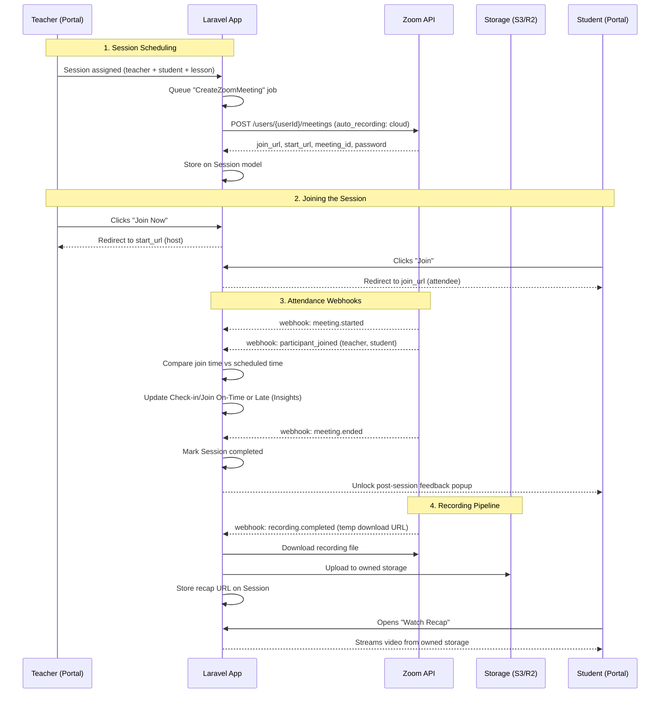

# Zoom Integration

Detailed design for how Zoom powers session delivery, attendance tracking, and recap videos.

## Flow Diagram

## 1. Meeting Creation (when a session is scheduled)
- Use a **Server-to-Server OAuth app** (not user-level OAuth) — lets the Laravel backend create/manage meetings on behalf of teachers without each teacher individually connecting their own Zoom account
- When a `Session` is created (teacher assigned to a student/lesson), a queued Laravel job calls Zoom's `POST /users/{userId}/meetings` API to create the meeting
- `{userId}` is the **Zoom user who hosts the meeting** — the Zoom account's email or internal Zoom user ID, not your own app's user ID. Since Server-to-Server OAuth has no "me" concept, this must be explicitly resolved per teacher (e.g. a `zoom_user_id`/provisioning email stored on `TeacherProfile`, populated at onboarding — mirrors the pattern already seen on the Teacher Credentials page for other provisioned tool logins)
- Store the returned `join_url`, `meeting_id`, `start_url`, and `password` on the `Session` model
- This is what powers every **"Join"/"Join Now"** button across the product — it opens the stored `join_url`/`start_url` directly, confirmed from the real product screenshots (not just a stated integration)

### Zoom seat/licensing strategy (decision needed)
- **Option A — one licensed seat per teacher.** `{userId}` = that teacher's own Zoom account. Clean 1:1 mapping, simplest to reason about, matches the provisioned-account pattern already seen elsewhere in the product. Costs a Zoom license per teacher.
- **Option B — shared pool of licensed host accounts.** `{userId}` is chosen from a smaller pool based on availability at scheduling time. Cheaper, but adds concurrency-management complexity (must track which pooled account is free for a given time slot).
- Recommendation: start with Option A given the implied scale (hundreds of sessions, many teachers) and existing provisioned-account pattern; revisit if licensing cost becomes a concern.

## 2. Teacher vs. Student Join Links
- Zoom returns both a `start_url` (host-privileges link) and a `join_url` (attendee link) for the same meeting
- **Teacher's "Join Now"** button uses `start_url` so they land as host automatically
- **Student's "Join"** button uses `join_url`

## 3. Attendance Tracking
- Zoom sends **webhooks** for `meeting.started`, `meeting.ended`, `meeting.participant_joined`, `meeting.participant_left`
- A Laravel webhook controller (request signature verified using Zoom's webhook secret) listens for these and updates the `Session`:
  - `participant_joined` timestamp vs. scheduled start time → auto-populates **Check-in on Time / Check-in Late** and **Join Sessions on Time / Late** in the teacher's Insights page, instead of relying on manual entry
  - `meeting.ended` → marks the session completed and unlocks the post-session feedback popup for the student

## 4. Recordings → "Watch Recap"
- Enable **cloud recording** on meeting creation (`settings.auto_recording: "cloud"`)
- Zoom fires a `recording.completed` webhook once processing finishes, with a temporary download URL
- A queued job downloads the recording and re-uploads it to owned storage (S3/Cloudflare R2) rather than linking Zoom's URL directly — gives control over expiry and access (only that student can view it) and avoids Zoom's default link expiration
- That stored URL is what the **"Watch Recap"** video player on the student dashboard points to

## 5. Physical (In-Person) Sessions
- Don't use Zoom at all — this is what the separate **Check-in/Check-out links** on the Teacher Profile page are for (a lightweight geolocation- or QR-based attendance system, unrelated to the Zoom webhook flow)
- See [Teacher Dashboard](../product/05-teacher-dashboard.md) → Teacher Profile Page

## 6. Failure Handling / Operational Considerations
- **Rate limits** — batch meeting creation via queued jobs rather than synchronous calls when scheduling sessions in bulk
- **Webhook retries** — Zoom retries failed webhook deliveries, so handlers must be idempotent (check current session state before applying an update)
- **Zoom seat/licensing strategy** — see above

See also: [Architecture](./architecture.md), [Tech Stack](./tech-stack.md), [Domain Model](./domain-model.md), [Build Plan](./build-plan.md)
